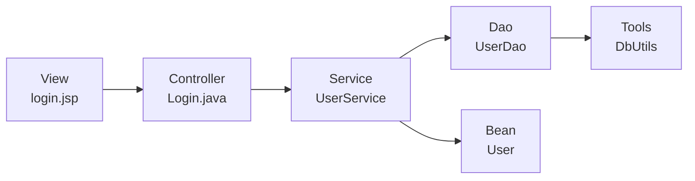

# 30_MVC开发模式

MVC：软件架构思想、设计规范。遵守后 JavaWeb 程序结构更清晰，每个模块只做自己的事。

| 层 | 全称 | 职责 | 本 Demo 对应 |
|----|------|------|--------------|
| **M** | Model | 实体 + 业务 + Dao | `User` / `UserService` / `UserDao` |
| **V** | View | 视图，数据展示 | `login.jsp` / `index.jsp` / `adminHome.jsp` |
| **C** | Controller | 控制器，接请求、调 M、决定去哪个 V | `Login`（Servlet） |

---

## 三层职责再拆

**Model（模型）**

- **实体类**：承载业务数据（数据库查出的数据赋值到实体类），如 `User`
- **业务类**：针对功能写逻辑，如 `UserService.login()`
- **Dao**：专门写数据库代码、拼 SQL 的类，如 `UserDao`

**View（视图）**

- JSP，只负责展示数据

**Controller（控制器）**

- Servlet：接收请求和参数 → 调用 Model → 根据处理结果跳转到对应 View

---

## Demo 需求

用户表两种身份：管理员、用户。

启动后首页：

- 登录：管理员进后台界面，普通用户回首页
- 数据展示：点「查看详情」检测是否登录，未登录先登录，已登录正常查看

登录之后就可以做后台数据维护了。

---

## 示例项目结构

```
11/
├── src/
│   ├── db.properties                 数据库配置
│   └── com/la/mvc/
│       ├── bean/User.java            实体类
│       ├── controller/Login.java     控制器（Servlet）
│       ├── dao/UserDao.java          数据库访问
│       ├── service/UserService.java  业务逻辑
│       └── tools/
│           ├── DbUtils.java          数据库工具类
│           └── FileUpload.java       文件上传工具类
└── web/
    ├── index.jsp                     首页
    ├── login.jsp                     登录页
    ├── adminHome.jsp                 管理员后台
    └── WEB-INF/lib/                  jar 包
```

分层依赖方向（Controller → Service → Dao → DbUtils）：



---

## M：实体类 User

对应 user 表，属性与列一一对应：`id`、`username`、`password`、`role`、`money`、`createTime`。

要点：

1. 私有属性 + getter/setter
2. 无参构造 + 全参构造
3. 重写 `toString()`（IDEA：`Alt + Insert` → `toString()`，模板选 String concatenation）

```java
public class User {
    private Integer id;
    private String username;
    private String password;
    private Integer role;
    private Double money;
    private String createTime;
    // getter / setter / 构造 / toString
}
```

实体类作用：把 `HashMap` / 查询结果变成有类型、好点号调用的对象。

---

## M：Dao 层 UserDao

只做数据库 CRUD，不管业务判断。

```java
public class UserDao {
    private DbUtils dbUtils = new DbUtils();

    public ArrayList<HashMap<String, Object>> queryUserByUsername(String username) {
        String sql = "select * from user where username = '" + username + "'";
        return dbUtils.query(sql);
    }
}
```

---

## M：业务层 UserService

调 Dao 拿数据 → 装进 User → 做业务判断 → 返回结果标识。

```java
public class UserService {
    private UserDao userDao = new UserDao();

    public String login(String username, String password) {
        // 1. 通过 username 查用户
        ArrayList<HashMap<String, Object>> list = userDao.queryUserByUsername(username);

        // 2. 用 User 实体承载数据
        if (list.isEmpty()) {
            return "error";
        }
        HashMap<String, Object> map = list.get(0);
        User user = new User(
                Integer.parseInt(map.get("id").toString()),
                map.get("username").toString(),
                map.get("password").toString(),
                Integer.parseInt(map.get("role").toString()),
                Double.parseDouble(map.get("money").toString()),
                map.get("create_time").toString()
        );

        // 3. 校验密码
        if (!user.getPassword().equals(password)) {
            return "error";
        }

        // 4. 判断身份：role == 0 → 普通用户
        if (user.getRole() == 0) {
            return "user";
        }
        return "admin";
    }
}
```

登录返回三种结果：

| 返回值 | 含义 | 控制器跳转 |
|--------|------|------------|
| `"user"` | 普通用户登录成功 | `index.jsp` |
| `"admin"` | 管理员登录成功 | `adminHome.jsp` |
| `"error"` | 用户不存在或密码错误 | `login.jsp?error=500` |

---

## C：控制器 Login（Servlet）

只做「接值 → 调 Model → 跳页面」，不写业务。

```java
@WebServlet(name = "Login", value = "/Login")
public class Login extends HttpServlet {
    @Override
    protected void doGet(HttpServletRequest request, HttpServletResponse response)
            throws ServletException, IOException {
        // 接值
        String username = request.getParameter("username");
        String password = request.getParameter("password");

        // 调业务类
        UserService service = new UserService();
        String result = service.login(username, password);

        // 根据结果跳转
        if (result.equals("user")) {
            response.sendRedirect("index.jsp");
        } else if (result.equals("error")) {
            response.sendRedirect("login.jsp?error=500");
        } else {
            response.sendRedirect("adminHome.jsp");
        }
    }

    @Override
    protected void doPost(HttpServletRequest request, HttpServletResponse response)
            throws ServletException, IOException {
        doGet(request, response);
    }
}
```

---

## V：视图层

### login.jsp

```jsp
<%@ taglib prefix="c" uri="http://java.sun.com/jsp/jstl/core" %>
<form action="Login" method="post">
  <p><input type="text" name="username" placeholder="用户名"></p>
  <p><input type="password" name="password" placeholder="密码"></p>
  <p><button>Login</button></p>

  <c:if test="${param.error != null}">
    <p>账号密码错误</p>
  </c:if>
</form>
```

- EL 表达式：`${值}`，接收传到页面的数据
- JSTL 标签库：`<c:if>` 条件判断（注意引入 taglib）
- `param.error` 取 URL 上的 `error` 参数，用来显示错误提示


#### 注：

| jar包          | 角色       | 内容                                  |
| -------------- | ---------- | ------------------------------------- |
| `jstl.jar`     | 接口 / API | JSTL 标签的定义                       |
| `standard.jar` | 实现       | 标签真正执行的代码（Jakarta Taglibs） |

常用标签

| 标签                                | 用途            |
| ----------------------------------- | --------------- |
| `<c:if>`                            | 条件判断        |
| `<c:choose>/<c:when>/<c:otherwise>` | 多分支          |
| `<c:forEach>`                       | 遍历集合        |
| `<c:out>`                           | 输出（可转义）  |
| `<c:set>` / `<c:remove>`            | 设置 / 移除变量 |

示例

```
<c:set var="age" value="20"/>
<c:if test="${age >= 18}">成年</c:if>
```

```
<c:set var="score" value="70"/>
<c:choose>
    <c:when test="${score>=90}">优秀</c:when>
    <c:when test="${score>=60}">及格</c:when>
    <c:otherwise>不及格</c:otherwise>
</c:choose>
```

```
<%-- 数字循环 --%>
<c:forEach begin="1" end="5" var="i">
    ${i}
</c:forEach>
<%-- 集合遍历（后端传list）--%>
<c:forEach items="${list}" var="item">
    ${item}
</c:forEach>

```

```
<c:set var="msg" value="<b>测试</b>"/>
<c:out value="${msg}"/>
```

```
<c:set var="name" value="小明"/>
${name}
<c:remove var="name"/>
```


这两个包是 JSP 里用 JSTL 标签（如 `<c:if>`）的必备依赖，`jstl.jar` 给接口，`standard.jar` 给实现。


### index.jsp / adminHome.jsp

首页放登录链接；后台页先简单展示，后续做数据维护。

---

## 登录完整流程

```
用户打开 login.jsp 输入账号密码
        ↓ POST /Login
Login（Servlet）getParameter 接值
        ↓
UserService.login(username, password)
        ↓
UserDao.queryUserByUsername → DbUtils 查库
        ↓
HashMap → new User(...) 装载
        ↓
校验密码、判断 role
        ↓
返回 "user" / "admin" / "error"
        ↓
Servlet 重定向到对应页面
        ↓
login.jsp 用 <c:if> + EL 显示错误（若是 error）
```

---

## 工具类说明

### DbUtils

- 静态代码块读 `db.properties`、加载驱动、获取连接
- `query(sql)`：普通查询，返回 `ArrayList<HashMap<String, Object>>`
- `preparedQuery(sql, param...)`：预处理查询，`?` 占位防 SQL 注入
- `update(sql)`：执行增删改

`db.properties`：

```properties
db.driver=com.mysql.jdbc.Driver
db.url=jdbc:mysql://localhost:3308/...
db.username=root
db.password=...
```

### FileUpload（文件上传工具类）

把 commons-fileupload 流程封装成方法，一次拿到表单所有值：

```java
HashMap<String, String> map = FileUpload.getFromValues(request);
```

- 普通字段：字符流读出，`map.put(name, 输入的值)`
- 文件字段：时间戳+随机数重命名保存到 `img`，`map.put(name, 新文件名)`；未选文件则存 `"没有上传文件"`
- 工具类特点：静态方法、可复用、专门解决某类问题

---

## 注意点

1. **分层别乱调**：Controller 不写 SQL，Dao 不做业务判断，JSP 不写复杂逻辑
2. **String 结果标识**：`login()` 用 `"user"/"admin"/"error"` 传结果，简单但字符串易写错，后面可改为常量或枚举
3. **SQL 注入**：`UserDao` 里字符串拼接 SQL 有注入风险，正式项目用 `preparedQuery`
4. **HashMap → User**：手动 set/构造赋值；字段多时会啰嗦，后面可接触 BeanUtils 等工具
5. **错误提示**：靠 URL 参数 `?error=500` + JSTL `<c:if>`，没有 JSTL 会报错，记得导 jar 或配 taglib
6. **表单编码**：登录表单没写 `enctype`，默认 `application/x-www-form-urlencoded` 即可；只有文件上传才要 `multipart/form-data`

---

## 和前面知识的串联

| 知识点 | 在本 Demo 的用法 |
|--------|------------------|
| Servlet | `Login` 作为 Controller，`@WebServlet("/Login")` |
| JSP + 九大对象 | `request.getParameter` 取参，页面展示 |
| JDBC / DbUtils | Dao 查 user 表 |
| IO 流 | `FileUpload` 读写上传文件 |
| 文件上传 | commons-fileupload 封装进工具类 |
| 集合 | `ArrayList<HashMap>` 装查询结果，`HashMap` 装表单值 |
| 面向对象 | 实体类封装数据，分层各司其职 |
