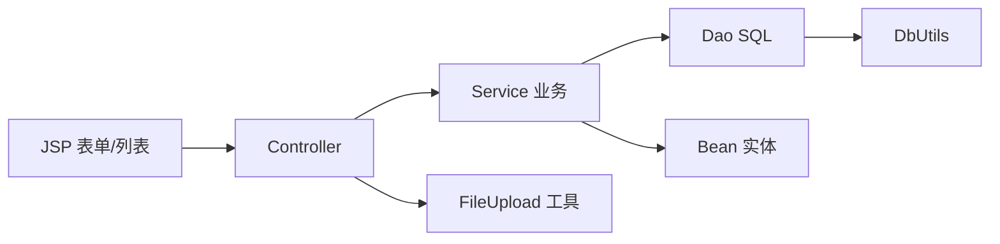

# 31_MVC商品管理Demo

## 功能一览

| 功能 | 入口 | Controller | 视图 |
|------|------|------------|------|
| 登录 | `login.jsp` | `Login` | 普通用户 → `index.jsp`；管理员 → `QueryGoodsAll` |
| 商品列表 | 后台首页 | `QueryGoodsAll` | `adminHome.jsp` |
| 添加商品 | 「添加商品」 | `AddGoods` | `add_goods.jsp` → 成功回列表 |
| 编辑商品 | 列表「编辑商品」 | `QueryGoodsById` → `UpdateGoodsById` | `update_goods.jsp` |
| 下架商品 | 列表「下架商品」 | （预留，逻辑删除） | — |


## 项目结构

```
11/
├── src/
│   ├── db.properties
│   └── com/la/mvc/
│       ├── bean/          Goods.java, User.java
│       ├── controller/    Login, AddGoods, QueryGoodsAll, QueryGoodsById, UpdateGoodsById
│       ├── dao/           GoodsDao, UserDao
│       ├── service/       GoodsService, UserService
│       └── tools/         DbUtils, FileUpload
└── web/
    ├── index.jsp / login.jsp / adminHome.jsp
    ├── add_goods.jsp / update_goods.jsp
    ├── img/                    上传图片保存目录
    └── WEB-INF/lib/            mysql、commons-fileupload、commons-io 等
```

调用链：




## 实体类

### Goods（商品表）

| 属性 | 含义 |
|------|------|
| `id` | 主键 |
| `name` | 商品名称 |
| `price` | 价格 |
| `cnt` | 库存数量 |
| `pic` | 图片文件名（无图时为 `"没有上传文件"`） |

两个构造器：全参（查库回来用）和无 id（添加时用）。重写 `toString()`。

### User

与 30 相同：`id / username / password / role / money / createTime`。


## 路由与控制器

| 访问路径 | 作用 | 核心代码 |
|----------|------|----------|
| `POST /Login` | 登录 | `UserService.login` → 按身份 `sendRedirect` |
| `GET /QueryGoodsAll` | 查全部 | `queryGoodsAll()` → `setAttribute` → 转发 `adminHome.jsp` |
| `POST /AddGoods` | 添加 | `FileUpload.getFromValues` → `addGoods(map)` → `sendRedirect("QueryGoodsAll")` |
| `GET /QueryGoodsById?id=` | 查单条 | `queryGoodsById(id)` → 转发 `update_goods.jsp` |
| `POST /UpdateGoodsById` | 修改 | `FileUpload.getFromValues` → `updateGoodsById(map)` → 回列表 |

### 两个跳转方式（重要）

| 方式 | 用在哪 | 原因 |
|------|--------|------|
| `response.sendRedirect(...)` | 登录跳角色首页、增改成功回列表 | 地址栏变化，防重复提交 |
| `request.getRequestDispatcher(...).forward(...)` | 列表页、编辑页 | 要带 **request 作用域** 的 `list` / `goods` 对象 |

```java
// 转发：数据放 request，JSP 用 EL 取
request.setAttribute("list", list);
request.getRequestDispatcher("adminHome.jsp").forward(request, response);
```

重定向不能带 Java 对象，复杂类型只能转发。


## Service 业务层

### GoodsService

1. **addGoods(map)**  
   从 `HashMap` 取 `name/price/cnt/pic` → `new Goods(...)` → Dao 插入 → `rows == 1` 返回 true。

2. **queryGoodsAll()**  
   Dao 返回 `ArrayList<HashMap>` → 循环 `new Goods(...)` 装载 → `List<Goods>` 给页面。

3. **queryGoodsById(id)**  
   取第一条 HashMap → 转 `Goods` 返回。

4. **updateGoodsById(map)**（逻辑最重）  
   - 比对 `pic` 是否为 `"没有上传文件"`：  
     - **没传新图** → `updateGoods(...)` 只改 name/price/cnt  
     - **传了新图** → `updateGoodsByPic(...)` 连 pic 一起改，并 **删除旧图文件**  
   - 删除旧图：`new File(path + "\\" + oldPic).delete()`  
   - 两个条件都满足才返回 true

### UserService

与 30 相同：查用户 → 装 User → 校验密码 → 按 `role` 返回 `"user"` / `"admin"` / `"error"`。

变化点：管理员登录成功后不再直接进 `adminHome.jsp`，而是：

```java
response.sendRedirect("QueryGoodsAll");  // 先查数据再进后台
```


## Dao 层 SQL

```java
// 添加
insert into goods (name,price,cnt,pic) values ('...','...','...','...')

// 全查
select * from goods

// 按 id 查
select * from goods where id = '...'

// 不改图
update goods set name='...',price='...',cnt='...' where id = '...'

// 改图
update goods set name='...',price='...',cnt='...',pic='...' where id = '...'
```

注意：字符串拼 SQL 有注入风险，正式项目应用 `DbUtils.preparedQuery` / 预处理。


## 视图层（JSP + JSTL）

### adminHome.jsp 列表

```jsp
<c:choose>
    <c:when test="${list == []}">
        <h1>暂无数据</h1>
    </c:when>
    <c:otherwise>
        <table>
            ...
            <c:forEach items="${list}" var="goods">
                <tr>
                    <td>${goods.name}</td>
                    <td>${goods.price}</td>
                    <td>${goods.cnt}</td>
                    <td>
                        <c:if test="${goods.pic != '没有上传文件'}">
                            
                        </c:if>
                    </td>
                    <td>
                        <a href="QueryGoodsById?id=${goods.id}">编辑商品</a>
                        <a href="">下架商品</a>
                    </td>
                </tr>
            </c:forEach>
        </table>
    </c:otherwise>
</c:choose>
```

JSTL 对照：

| 标签 | 相当于 |
|------|--------|
| `<c:choose>` | switch |
| `<c:when>` | case |
| `<c:otherwise>` | default |
| `<c:forEach>` | for 遍历集合 |
| `<c:if>` | if 条件 |

### update_goods.jsp 编辑

两个 **hidden** 字段很关键：

```jsp
<input type="hidden" name="id" value="${goods.id}">
<input type="hidden" name="oldPic" value="${goods.pic}">
```

- `id`：修改时要定位行  
- `oldPic`：换新图后要删掉旧文件  

图片区：

```jsp
<c:if test="${goods.pic != '没有上传文件'}">
    
</c:if>
```

### add_goods.jsp

标准文件上传表单：

```jsp
<form action="AddGoods" method="post" enctype="multipart/form-data">
    name / price / cnt  文本
    pic  <input type="file">
</form>
```


## FileUpload 工具类

封装 commons-fileupload，一次拿全部表单值：

```java
HashMap<String, String> map = FileUpload.getFromValues(request);
```

| 情况 | map 里存什么 |
|------|----------------|
| 普通字段 | `key → 输入的文本` |
| 选了文件 | `key → 重命名后的文件名`，另存 `path → img绝对路径` |
| 没选文件 | `key → "没有上传文件"` |


`updateGoodsById` 里删旧图用的 `path`，就是工具类放进 map 的。


## 完整业务流：改商品并换图

```
列表点「编辑商品」
  → QueryGoodsById?id=3
  → 查出 Goods，setAttribute("goods")
  → 转发 update_goods.jsp（表单回填，含 hidden id/oldPic）
  → 用户改信息、可选新图片，提交
  → POST UpdateGoodsById
  → FileUpload 解析出 map（含新 pic / "没有上传文件"、oldPic、path）
  → GoodsService.updateGoodsById
       ├─ 未换图：update name,price,cnt
       └─ 换了图：update 含 pic + File.delete(旧图)
  → 成功 sendRedirect("QueryGoodsAll")
  → 列表页看到新数据
```


