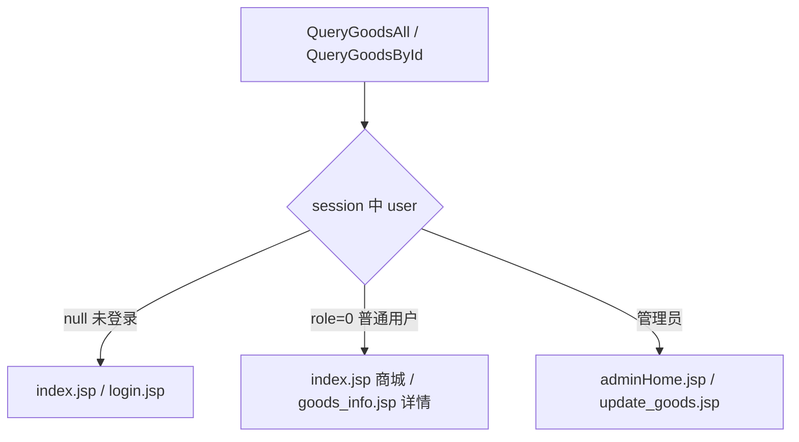

# 32_Session鉴权与下单

## 新增点

| 知识点 | 用在哪 |
|--------|--------|
| Session 存对象 | 登录后 `session.setAttribute("user", user)` |
| Session 判身份 | `QueryGoodsAll` / `QueryGoodsById` 三路分支 |
| 欢迎语 / 退出 | `index.jsp` 用 `sessionScope.user` 判断 |
| 下单业务 | `AddOrder` → `OrderService` → `OrderDao` |
| 默认启动页 | `web.xml` 的 `welcome-file-list` |


## 项目结构

```
11/src/com/la/mvc/
├── bean/        User, Goods
├── controller/  Login, QueryGoodsAll, QueryGoodsById,
│                AddGoods, UpdateGoodsById,
│                DeleteGoodsById, AddOrder          ← 新增 2 个
├── service/     UserService, GoodsService, OrderService   ← 新增订单
├── dao/         UserDao, GoodsDao, OrderDao                ← 新增订单
└── tools/       DbUtils, FileUpload

web/
├── index.jsp          社区商城首页（商品卡片，内嵌 CSS）
├── goods_info.jsp     商品详情 + 下单表单       ← 新增
├── error.jsp          操作失败页               ← 新增
├── adminHome.jsp      管理员后台列表
├── add_goods.jsp / update_goods.jsp / login.jsp
└── WEB-INF/web.xml    配置默认启动页 QueryGoodsAll
```

---

## 一、Session 保持登录

之前登录只靠 URL 重定向，用户信息丢了。本节把 **User 对象放进 Session**。

### UserService.login 增加 session 参数

```java
public String login(String username, String password, HttpSession session) {
    // ...查询、校验密码同前...

    // 密码正确后：存入 session
    session.setAttribute("user", user);

    if (user.getRole() == 0) {
        return "user";
    }
    return "admin";
}
```

### Login 传入 session

```java
HttpSession session = request.getSession();
String result = service.login(username, password, session);

// 用户、管理员都统一走查询 Servlet
response.sendRedirect("QueryGoodsAll");
```

登录成功后不再直接跳页面，而是**都去 `QueryGoodsAll`**，由它按身份决定转发哪张视图。

---

## 二、按身份分流视图（核心）

### QueryGoodsAll：同一份 list，不同页面

```java
List<Goods> list = goodsService.queryGoodsAll();
request.setAttribute("list", list);

HttpSession session = request.getSession();
User user = (User) session.getAttribute("user");

if (user == null) {
    // 未登录
    request.getRequestDispatcher("index.jsp").forward(request, response);
} else if (user.getRole() == 0) {
    // 普通用户
    request.getRequestDispatcher("index.jsp").forward(request, response);
} else {
    // 管理员
    request.getRequestDispatcher("adminHome.jsp").forward(request, response);
}
```

### QueryGoodsById：详情页 vs 编辑页

```java
request.setAttribute("goods", goods);
User user = (User) request.getSession().getAttribute("user");

if (user == null) {
    response.sendRedirect("login.jsp");            // 未登录去登录
} else if (user.getRole() == 0) {
    request.getRequestDispatcher("goods_info.jsp").forward(...);  // 用户看详情
} else {
    request.getRequestDispatcher("update_goods.jsp").forward(...); // 管理员编辑
}
```

三路分支图：



**为什么用 Session 而不是 URL 传 user？**  
用户对象不能拼在地址栏；Session 是服务器端会话，浏览器每次请求都会带上同一会话号，适合存登录状态。

---

## 三、首页 index.jsp（社区商城）

特点：

1. 内嵌 CSS 商品卡片流：`flex` 布局、悬停上浮阴影
2. 登录状态用 **`sessionScope.user`**：

```jsp
<c:if test="${empty sessionScope.user}">
    <a href="login.jsp">登录</a>
</c:if>
<c:if test="${not empty sessionScope.user}">
    欢迎，${sessionScope.user.username}
    <a href="logout.jsp">退出登录</a>
</c:if>
```

3. 商品卡片点击进详情：

```jsp
<a href="QueryGoodsById?id=${goods.id}">
    <div class="goods-card">
        
        <p class="goods-name">${goods.name}</p>
        <p class="goods-price">¥${goods.price}</p>
    </div>
</a>
```

`sessionScope.user` 写法表示「从 session 作用域取 user」，比 `${user}` 更明确。

---

## 四、下单功能

### 表单 goods_info.jsp

```jsp
<form action="AddOrder" method="post">
    <input type="hidden" name="goodsId" value="${goods.id}">
    <input type="hidden" name="price" value="${goods.price}">
    <input type="number" name="count" min="1" value="1" max="${goods.cnt}">
    <button>下单</button>
</form>
```

| 字段 | 说明 |
|------|------|
| `goodsId` | hidden 带出商品 id |
| `price` | hidden 带出单价 |
| `count` | 用户输入数量，`max` 限库存 |

### Controller：AddOrder

```java
String goodsId = request.getParameter("goodsId");
String count = request.getParameter("count");
String price = request.getParameter("price");

// 从 Session 取当前登录用户
User user = (User) request.getSession().getAttribute("user");

boolean bol = orderService.addOrder(goodsId, count, price, user.getId());
if (bol) {
    response.sendRedirect("QueryOrderAll");   // 去订单列表
} else {
    response.sendRedirect("error.jsp");
}
```

### Service：算总价

```java
double sumPrice = Double.parseDouble(price) * Double.parseDouble(count);
int rows = orderDao.addOrder(goodsId, count, sumPrice, id);
```

### Dao：插入 order 表

```java
String sql = "insert into `order` (u_id, g_id, sumPrice, create_time, cnt) values ('" +
        id + "','" + goodsId + "','" + price + "', now(),'" + count + "')";
return dbUtils.update(sql);
```

注意：表名 `order` 是 MySQL 关键字，要加反引号 `` `order` ``。

订单表字段：

| 列 | 含义 |
|----|------|
| u_id | 下单用户 id（来自 Session） |
| g_id | 商品 id |
| sumPrice | 总价 = 单价 × 数量 |
| create_time | 下单时间 `now()` |
| cnt | 购买数量 |


## 五、物理删除商品 DeleteGoodsById

与改图删旧图类似的「文件 + 数据」两步：

```java
public boolean deleteGoodsById(String id, String pic, String path) {
    boolean bol = true;

    if (!pic.equals("没有上传文件")) {
        File file = new File(path + "\\" + pic);
        bol = file.delete();          // 1. 先删图片文件
    }

    int rows = goodsDao.deleteGoodsById(id);  // 2. 再删数据库行

    return rows == 1 && bol;
}
```

Dao：

```java
String sql = "delete from goods where id = '" + id + "'";
```

链接把 `pic` 一并传出：

```jsp
<a href="DeleteGoodsById?id=${goods.id}&pic=${goods.pic}">下架商品</a>
```


## 六、web.xml 默认启动页

```xml
<welcome-file-list>
    <welcome-file>QueryGoodsAll</welcome-file>
</welcome-file-list>
```

访问项目根路径时直接进查询 Servlet，保证「一进来就带数据、并按身份分流」，而不是空的 index。


## 七、完整业务流：用户登录 → 下单

```
打开根路径
  → QueryGoodsAll（默认页）
  → Session 无 user → index.jsp 商城（展示商品卡片）
  → 点登录 → Login
  → UserService.login 校验 + session.setAttribute("user", user)
  → redirect QueryGoodsAll
  → Session 有 user：普通用户留在 index.jsp，管理员进 adminHome.jsp
  → 点商品卡片 → QueryGoodsById?id=x
  → role=0 → goods_info.jsp（详情）
  → 填数量，提交 AddOrder
  → Session 取 user.getId()
  → OrderService 算 sumPrice → OrderDao 插入 order 表
  → 成功去订单列表 / 失败去 error.jsp
```


## 注意点

1. **空指针要防**：`user` 可能为 null，必须先判 `user == null` 再 `user.getRole()`，否则没登录就 NPE。
2. **Session 存放时机**：`login` 成功才 `setAttribute`；退出应 `session.invalidate()`（代码中 `logout.jsp` 待补）。
3. **单价来自前端**：`price` 是隐藏域，可被篡改；正式项目应以后端查库价为准。
4. **库存校验**：`count` 的 `max` 只是前端限制，后端未校验库存，可超卖。
5. **`order` 表名**：关键字要加反引号。
6. **删除顺序**：先删文件再删库行，两步都要成功才算 true。
7. **转发与重定向**：带 `list`/`goods` 用 forward；登录后、增删改后用 redirect。


